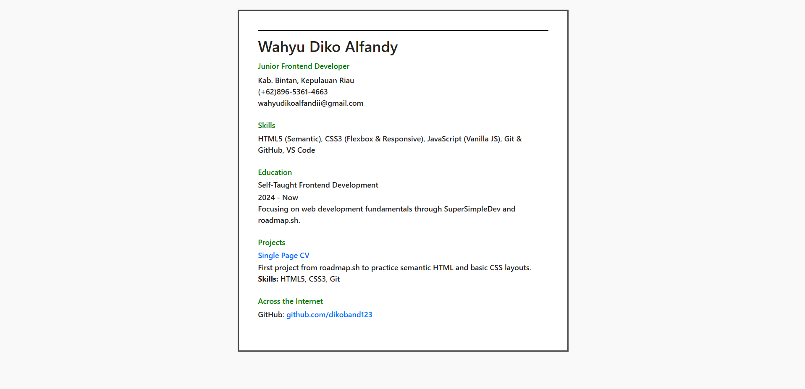
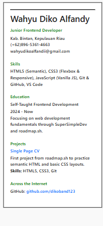

# Single Page CV

---

## Problem & Purpose (Why)

Many digital CVs and web portfolios are bloated, heavily dependent on frameworks, or break on mobile screens. I built this **Single Page CV to provide a lightweight, fast-loading, and clean web profile using purely native web standards—without any external frameworks**.

This project was inspired by and developed as part of the [roadmap.sh Frontend Projects](https://roadmap.sh/projects/single-page-cv) curriculum.

---

## Live Demo & Preview (What)

- **Live Preview:** [https://dikoband123.github.io/single-page-cv/](https://dikoband123.github.io/single-page-cv/)
- **Source Code:** `github.com/dikoband123/single-page-cv`

---

## Features & Tech Stack (How)

### Tech Stack

- **HTML5** – Document layout and semantic markup
- **CSS3** – Custom layout styling, typography, and responsive constraints
- **Git & GitHub** – Version control, branching, and source code management

### Key Features

- **100% Semantic HTML5**: Structured using appropriate elements (`<header>`, `<main>`, `<section>`, `<article>`, `<address>`, and `<footer>`) to ensure accessibility and clean code architecture.
- **Fully Responsive**: Styled with fluid widths (`max-width`) and `box-sizing: border-box` to adapt seamlessly across desktop, tablet, and mobile screens.
- **Minimalist Design**: Clean typography using system font stacks, balanced line height, and targeted color accents for headings.
- **Accessible Contact Links**: Direct interactive links for profiles and contacts that open seamlessly in new tabs.

---

## Learning Journey & Challenges

Building this project independently was less about writing code and more about understanding the problem-solving mindset behind web development:

1. **Semantic HTML vs. Div Soup**: Moving away from overusing `<div>` tags in favor of meaningful elements (`<header>`, `<section>`, `<article>`) to improve accessibility (screen readers) and write cleaner, maintainable code.
2. **Responsive Layouts**: Fixing horizontal scrolling on mobile screens by using dynamic `max-width` instead of fixed pixel widths.
3. **Typography & Visual Hierarchy**: Learning how the right balance of `line-height`, `margin`, and `padding` makes key information easier to read for recruiters.

---

## Preview

### Desktop



### Mobile



---

## Project Structure

```text
single-page-cv/
├── index.html    # Main HTML structure with semantic elements
├── style.css     # Custom responsive styles
└── README.md     # Project documentation
```

---

## Author

- **Wahyu Diko Alfandy**
- **GitHub**: [@dikoband123](https://github.com/dikoband123)
- **Email**: wahyudikoalfandii@gmail.com

---

## References

- Project Roadmap: [roadmap.sh - Single Page CV](https://roadmap.sh/projects/single-page-cv)
- Practice Framework: [SuperSimpleDev](https://www.youtube.com/@SuperSimpleDev)
